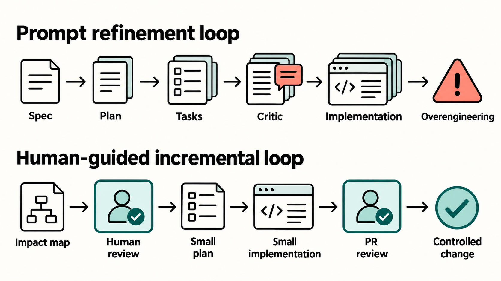

## Scenario

We have a 13 year old codebase, you know what it means, and we are developing with AI Agents. The more the models improve the more quality code they generated, but recently is not happening anymore. Benchmark for models are simply not applicable to everything, they are **non deterministic and the only benchmark that matter is how it behave in your harness**.

We still do Pull Request of the code, because in a 13 years old codebase, checking the agent result is still needed.

## Our Harness (high level)

We use Spec Driven Design, based on Azure DevOps Work Item, and the real advantage of using AI **is that it can navigate quickly a big and old codebase telling where to apply the new code to satisfy the specifications.**. Usually another advantage is, when we have a good spec and plan, task and implementation phase can be 
done by a smaller model.

But since tokens are quite cheap right now, we device a method to have the agent choose the right model based on the complexity of the task and the current context. 

It worked well, until now.

## The problem

Latest PR contains quite often overengineered code. Lots of code complexity to accomplish simple tasks, but what is really bad is unnecessary complexity in core code.

I finished yesterday the implementation and started to look at the code, one of the most used class in the system was almost entirely changed. It is a timer orchestrator and from the plan it should only need some async love and a couple of settings. The field declaration started with two new ConcurrentDictionary.

> Evaluation of quality of a model in writing code means really different thing based on the context.

I have my azdo-cli tool completely vibe coded and I do not care of the complexity, if sonarcloud pass check, codeQL is ok and a GH Copilot review is ok, I do not mid the code. It is different in code that is running in production for several customer on a complex codebase.

So I started asking: "Why you added so much complexity to something that should be simple?" The answer was astonishing, it told me the it got wrong, and removed 30% of the new code.

Then I asked the why of a new Method, and it told me that the specifications required less than 10 seconds stop of the polling routine. When I asked why a simple wait with a timeout of 10 seconds followed by a Kill of the thread was not enough it told me: ok you are right. 18 lines of code went away.

I asked the why of a really strange method that **returns a TaskCompletionSource in completed state**. It answererd me with a three long paragraph of blabberish starting with: *Since I need to know during stop if we are actively polling...*. I asked to explain me with great detail the scenario in which the existing _isPolling field is not enough. Answer is: there is no such case, I should have used that field instead.

That code is Not acceptable.

## New models are really better?

Generally speaking yes, but benchmarks are not really indicative. These new models are super fast so I do not think that they are increasing the number of parameters significantly, probably the post-training optimizations and architectural improvements are making the biggest difference. And I noticed one thing using local models, Qwen 3.8 is good because it generates a lot of intermediate token (thinking effort) that improve the prompt.

So if I ask *Write a C# routine to encrypt a file with a string as password*, you can start seeing the token generation for reasoning, the model starts generating token like: I need to check algorithm for encryptiong ..... those algorithms needs a fixed size key .... the user give a password ..... we need to derive a key from a password. And so on. Thus a simple prompt become one very detailed prompt that can then proceed to generating good code.

## My supposition (absolutely personal)

Now when you set Effort in the model you are telling how much reasoning and intermediate token generation you expect the model to perform before start working on your request. Also these kind of behavior is a training of the model, where the model is rewarded with some form of reinforcement for generating a prompt that is better than the original one.

> So these models are really good in taking a simple prompt and generating (with thinking effort) a better prompt that is then used to generate the real output tokens.

Our SDD (Spec Driven Development) model, and all SDD models in general, have the benefit of working in steps where each steps improve the original specification to arrive to a good result, often with smaller and less capable models. The art of choosing the right model/effort for each SDD phase is really one of the key of the efficacy of the approach.

So my suspect is that, with never model where the reasoning phase is becoming more and more prominent, we are starting to incur in this pattern.

1. I give model specification
2. Model thinks and generates good user stories, and functional requirements
3. after specs are done we move to plan
4. Model thinks a lot search the code, look at existing code, interfaces, uses agent and generates an implementation plan, it told us which file will be modified and what changes will be made.
5. We ask to convert in task
6. The model starts with GOOD and DETAILED specs and plan, so it start putting effort in improving the prompt
7. The result is sent to critic agent that try to find gap or problems, it is putting more effort in improving the prompt.
8. Then each Task is implemented in phase, even if you use Haiku, or sonnet, the effort forces the model to improve the prompt continuously.

The result is overengineering because when the process will continuously refine a prompt through multiple stages, where in each stage the model "reason", the result is that we reach a point in which the prompt is already good, but newer model are probably forced to improve the prompt no matter what (reward system pointed to this).

## How to cope with this?

Consider each Skill each agents everything in your harness as temporary, and something that can evolve with code, over time. Latest model bring me to a change in the SDD process where, for the core part of the project, the approach is much more **incremental with control by a human**. I still benefit from the higher capability of the model in **analyzing my code, understanding where to act, and find edge case**.

Then I ask to produce an impact/touch map telling me the list of files that it think should be added and all that needs to be modified. We have a discussion about that, then we identify the most critical parts. At that point we proceed with a plan-task-implement cycle where we try to work with very small phases. **The model comes out with a plan of no more than 30 lines of info.** It is simple to read and discuss about, then I let it implement with Minimum effort and usually small model. The result is much better.

## Conclusion

It is just a sensation, but I feel that newer AI models are increasingly focused on getting good result from bad prompting, more and more destined to persons that are not programmers. This generates a problem, when they are exposed to complex and detailed prompts, probably you need to set the effort at minimum to have good results.

