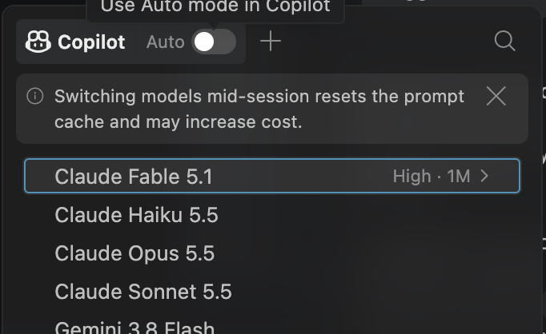
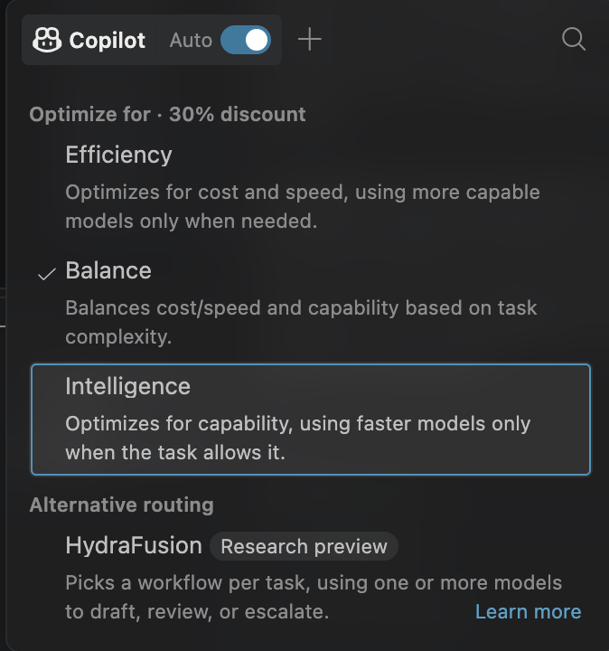

When coding assistants first arrived, the reassuring idea was that they were copilots, not autopilots. We stayed in control; the assistant helped us get where we wanted to go.

This approach changed in very few years, AI models become more and more capable, and every month some of the tasks that **we believed being part of our responsibility** are increasingly handled by the AI itself.

## From choosing a model to choosing a priority

The first screenshot shows the familiar model picker. I choose a model directly, I can switch model in the mid of the chat (albeit it warns about being unable to reuse cache) but definitively we have the duty of choosing the best model.

That interface assumes I know what I need: a faster model for a small task, perhaps a more capable one for a difficult task and so on. Choosing the right model for the tool is a matter of speed of execution and cost.

GitHub Copilot is the tool that has more model available out of the box, and choosing can be difficult. Not only I can choose between models with different capabilities of the same family, but I can access different families of models.

To help people optimize the choice, GH Copilot offered a discount in credits if you choose "auto", letting the **harness choose the best model automatically based on task**. This changed in a recent deploy of VsCode insider, now I can turn on Auto and select **Efficiency**, **Balance**, or **Intelligence**. The menu also presents HydraFusion as an alternative routing approach.

GitHub's [documentation on automatic model selection](https://docs.github.com/en/copilot/concepts/models/auto-model-selection) describes how Copilot considers task complexity alongside model availability and system health. The tiers express a preference: Efficiency favors cost, Balance weighs cost, quality, and latency, and Intelligence prioritizes quality. They don't lock every prompt to a particular model.

That distinction matters. I am no longer choosing the mechanism; I am choosing the goal and trusting the system to work out the mechanism. So I can now choose Auto/Efficiency if I think **that the task is simple and cost is a priority**, but even with this choice, if Copilot determines that a more capable model is needed, it may route the task accordingly.

This is a better approach than the old plain "auto", because we still choose between standard three level of capacity for simple/normal/demanding task, but letting the specific model selection be handled automatically based on the task's requirements.

## Less model shopping, more trust

I can see why this is appealing. The model landscape moves quickly, and most of us don't want to keep a mental spreadsheet of which model is best for every kind of task. If the system can send a simple request to a quick, inexpensive model and reserve more capable reasoning for harder work, that is useful.

> Optimizing token usage is a really important aspect of AI programming and if it can be handled automatically by the harness, is a clear advanage.

Also GitHub greatly encourage you to use this approach, because if you choose auto, you get a 30% discount on the usage on choosen model.

Since every provider is actually **struggling for capacity**, the fact that you got a 30% discount using auto, is a clear indication that GH is strongly confident that can deliver the same result using less token and to have less demand on the infrastructure.

> Too often I see people using always the most capable model, because they do not finish available tokens so they think: why should I save if I can use more capable model for the same cost?

The problem in using always the most capable model is that you not gain that specific capability to choose the best model. Once the provider will switch you to token based cost, you may find yourself paying more than necessary for tasks that could have been handled by a less capable model.

So I wouldn't say that Auto removes human control. It moves control up a level. Instead of choosing a model, I set a priority and decide whether I trust the routing policy. That's a reasonable trade for routine work, but it is still a trade.

## HydraFusion takes the idea further

The HydraFusion option in the screenshot points beyond selecting one model. Its description says it can pick a workflow for a task, using one or more models to draft, review, or escalate. GitHub presents it as a research preview, and this is simply automating a process that is already the most useful one: using subagent with different models.

- You need to search in the codebase? Use the smallest model, the task is not demanding.
- You need to do a simple session of coding based on clear specifications? Use an agent that use the smallest model, then a revisor that use medium capability model.
- Need to analyze log in the cloud, correlate to session log, and inspect codebase to look for a root cause of a bug that happens rarely? Probably an agent called Expert-Debugger that uses the most capable model.

With this approach the used model is determined by the task that will be sent to a subagent, and HydraFusion is an experiment to make this approach automatic

## Claude Code advisor: automation with a visible handoff

Claude Code's [advisor tool](https://code.claude.com/docs/en/advisor) is a useful comparison—and, in my view, worth including because it automates a different part of the decision.

The advisor **lets the main model consult a second, typically stronger model at moments such as choosing an approach, getting stuck on a recurring error, or checking work before completion.** The advisor gets the conversation and tool history, then returns guidance for the main model to use.

This approach is very similar, you usually start with the medium (sonnet) or even the simple (Haiku) model, but **during execution the harness can escalate to the model choosen as advisor (usually opus)**. In this situation you do not have a discount on tokens, but you benefit from the stronger model's guidance only when necessary.

There are practical limits. The feature is experimental and requires the Anthropic API; it isn't available through several other providers, including Amazon Bedrock and Microsoft Foundry. It also adds advisor usage, so the stronger model isn't free just because it is consulted selectively. Anthropic describes it as **most useful for long, multi-step tasks where a good decision can prevent mistakes from compounding—not for every quick question.**

## What does being “in control” mean now?

Month after Month models and harness become more and more autonomous, removing task from the hand of the human that conduct the operation. This is **absolutely not a bad thing, it makes the act of using a computer more democratic.**

And as I always told people: even before the AI revolution, the most important part of a project is managing requirement, knowing which problems will be solved by the software and how. The act of translating solutions into code, while important, is secondary to understanding and defining the problem correctly.

> the hardest single part of building a software system is deciding precisely what to build. (No Silver Bullet — Essence and Accident in Software Engineering,” IEEE Computer, April 1987) 

Gian Maria.
