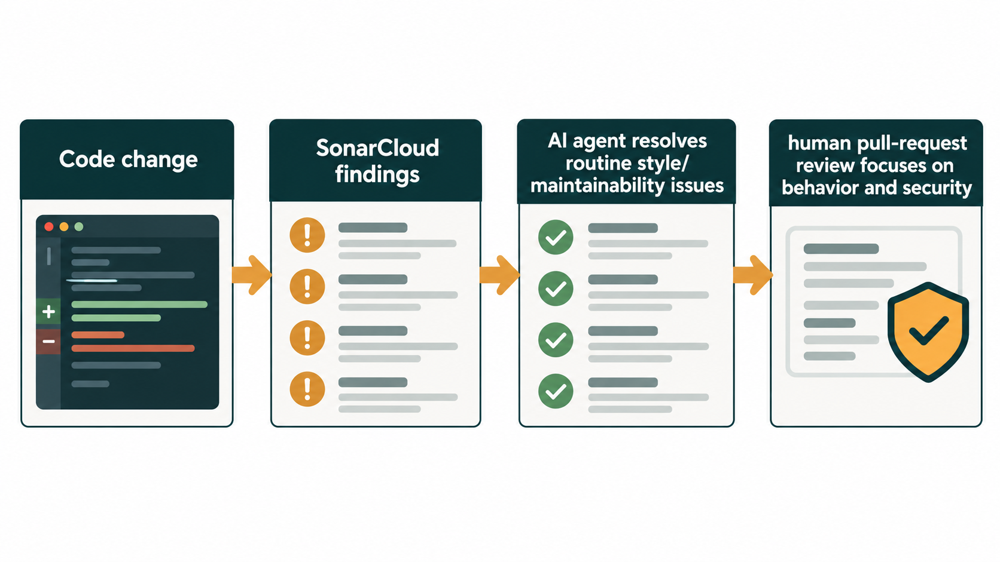

## Introduction

When an AI agent changes code, sometimes it write great code, sometimes write great but overengineered code, and sometimes write code that introduces subtle issues or violates project conventions. Sometimes the code is just bad. This does not mean that I'm against AI that writes code, humans have the same behaviour, and probably, overall, the AI is better than the average developer.

> Resistance is futile, nowadays AI writes code, period. It can be better or non better than you, but surely it is faster than everyone, and probably better than the average developer.

This is the reason why we use Pull Requests, checking other codes allow you to catch mistakes, enforce conventions, and maintain a consistent quality level across the codebase. But if you have the rule that your PR can be closed only after **a review of two other members of the teams** you see PR sitting there, especially if they are big. If code is written by an AI, this convention starts to be ineffective.

## What we look at in a Pull Request

Not the small thing, when code is in a Pull Request you search for mistakes, errors, or something that is not good and needs to be changed, we can't argue about minor stylistic or small issues. 

This means that those minor issues should be handled during development, something that the average developer (I'm in the same situation) does not do. The symptom is, take an old codebase, activate SonarCloud analysis and you will drown into issues. Some issues worth to be fixed, **others are less annoying, you could fix them, but they do not bring visible improvement in execution and they just add minor readability.

So, Sonar Analysis is used to catch Security Bugs, major bug and everything else is just sitting there.

## Sonar Cloud and analysis in the era of AI

AI is good in writing code, but **AI is superb in copying from what it see**. Ask to write a code that tests something and then, try giving an example class on how you write Tests. It will mimic your test code, and the code is more consistent in the codebase. In such a scenario, is convention, even the minor stylistic rules, still a minor thing?

> When you write code with AI, having a common style is really useful because the model learn a common style. If this common style is some established convention like Sonar Rules, it probably already seen them in training, and this helps.

AI loves consistency, AI loves seeing what it already saw in training. If the vast majority of the Test code in training is written with a pattern, it loves continuing using that pattern. If your codebase uses a non standard pattern, even if your pattern is better, the AI is forced to write code that **deviates from the training data, it can do it, but probably with lower quality**.

AI is also really fast, so, for the vast majority of stylistic rules, you can point a very small model, with low effort at the violations, and you can fix all of them in really no time. The change in code is often so simple that you can quickly catch-up with the tons of violation Sonar (or other analyzers) are reporting.

## Conclusion

In conclusion, while minor stylistic issues might seem trivial, they play a significant role in the era of AI-assisted development. Consistency in code style not only helps human developers but also allows AI models to generate code that aligns with the established patterns in your codebase and do not deviate from the standard.

Also, using standard conventions enforced by standard tools, probably helps models that are trained with lots of existing code that hopefully adhere to these conventions.

Gian Maria.
